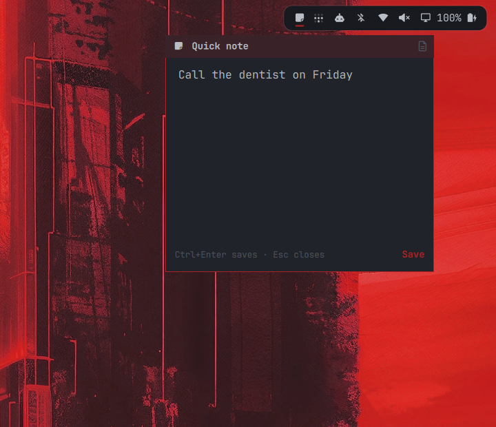

# Post-it

A post-it drawer for the [Omarchy](https://omarchy.org/) bar. Click the sticky-note icon, jot something down, press `Ctrl+Enter`, and the note is appended to a Markdown file that opens in [Omawrite](https://github.com/omacom-io/omawrite).



- Follows the active Omarchy theme (popup background, text, border, and accent colors) and updates live on `omarchy theme set`.
- Each note is appended under a timestamp heading, so all your notes read as one document:

  ```markdown
  # Quick notes

  ## 2026-10-15 11:27

  Call the dentist on Friday
  ```

- Unsaved text stays in the drawer when you close it.
- English and Spanish UI, picked from the system locale.

## Requirements

- Omarchy (Quattro)
- Omawrite, installed by default on Omarchy Quattro, for opening the notes file. Saving notes works without it.

## Installation

```sh
omarchy plugin add https://github.com/afrancoguevara/omarchy-postit.git --enable
```

The widget lands in the right section of the bar. Move it with `omarchy bar move afrancoguevara.postit --section <left|center|right>`.

## Usage

| Action | Result |
|---|---|
| Left click the icon | Open or close the post-it |
| `Ctrl+Enter` or **Save** | Append the note to the notes file |
| `Esc` | Close the post-it |
| Right click the icon, or the document icon in the post-it | Open the notes file in Omawrite |

### Keyboard shortcut

To open the post-it with `Super+N`, add this to `~/.config/hypr/bindings.lua`:

```lua
o.bind("SUPER + N", "Quick note", "omarchy-shell shell toggle afrancoguevara.postit '{}'")
```

## Configuration

Add keys to the widget's entry in `bar.layout` in `~/.config/omarchy/shell.json`. Both are optional.

```json
{ "id": "afrancoguevara.postit", "file": "~/Documents/Inbox.md", "language": "en" }
```

| Key | Default | Description |
|---|---|---|
| `file` | `~/Documents/Quick notes.md` (`Notas rápidas.md` in Spanish) | Markdown file the notes are appended to. `~/` is expanded. |
| `language` | `auto` | `auto` follows the system locale; `en` or `es` forces a language. |

## Removal

```sh
omarchy plugin remove afrancoguevara.postit
```

Your notes file is left in place. If you added the `Super+N` binding, remove it from `~/.config/hypr/bindings.lua`.

## License

MIT. See [LICENSE](LICENSE).
